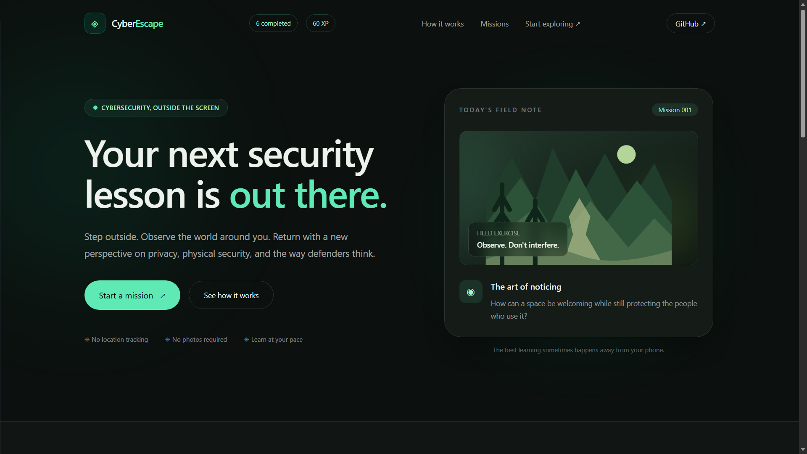
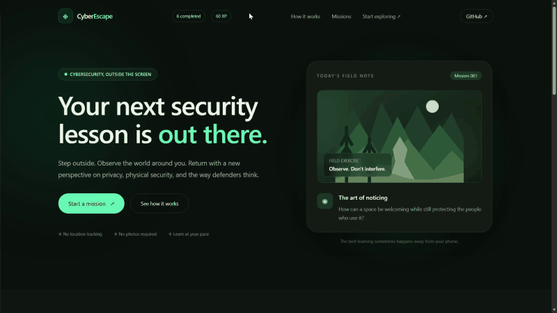
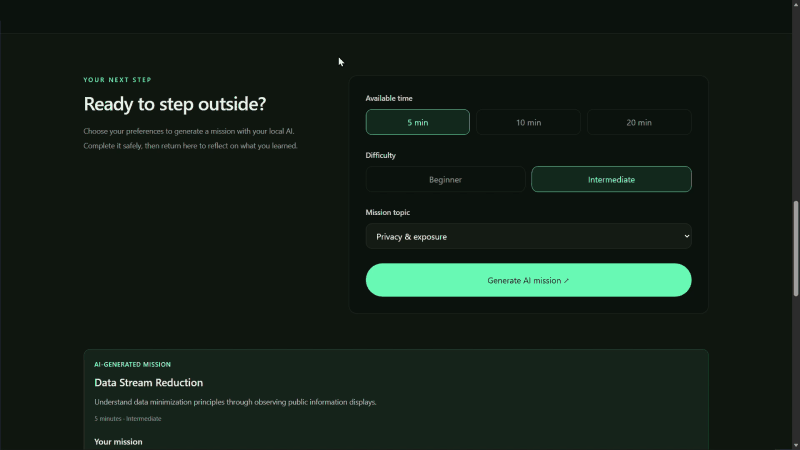

# CyberEscape 🌿🔐

**Walk. Observe. Think like a defender.**

CyberEscape is an AI-powered outdoor cybersecurity learning experience built for the **Hacktoberfest 2026 Touch Grass challenge**. It turns an ordinary walk into a short learning mission: step outside, observe your surroundings respectfully, connect what you notice to a cybersecurity or privacy principle, then return to reflect on what you learned.

Read the mission before the walk, put your phone away during the outdoor activity, and return afterward to submit a reflection. CyberEscape is about safe observation and defensive thinking—not auditing real places.

## Visual Demo



*The landing page introduces CyberEscape's outdoor cybersecurity learning experience.*

<!-- Optional: add the two animated GIFs from the visual-demo package to docs/assets/
     and uncomment these links once those files are present:


-->

## Why CyberEscape?

Cybersecurity learning often happens entirely on a screen. CyberEscape adds a real-world observation layer to topics such as privacy by design, clear public information, accessibility, safe communication, and security awareness.

## How It Works

1. **Choose a mission:** Select the duration, difficulty, and cybersecurity topic.
2. **Generate a mission:** Local AI creates an outdoor observation activity with instructions and safety boundaries.
3. **Go outside:** Read the instructions, put your phone away, and observe respectfully.
4. **Reflect afterward:** Answer questions about the principle you noticed, its potential impact, and a defensive improvement.
5. **Learn and progress:** Receive AI feedback and key takeaways. Successful reflections earn **10 XP** and appear in browser-local Mission History.

## Features

- AI-generated outdoor cybersecurity missions.
- Five topics: Physical Security, Privacy & Exposure, Social Engineering, Defensive Thinking, and Network Security Awareness.
- Configurable mission duration and difficulty.
- Safety boundaries included in missions.
- Reflection input checks and AI-assisted relevance validation.
- AI-generated feedback and defensive recommendations.
- XP, completed-mission counter, and browser-local Mission History.
- Loading states and error handling for local AI requests.
- Local inference through Ollama, using `gemma3:4b` by default.

## Tech Stack

| Component | Technology |
|---|---|
| Frontend | React, Vite, CSS |
| Backend | Python, FastAPI, Pydantic |
| Local AI | Ollama (`gemma3:4b` by default) |
| Progress storage | Browser `localStorage` |

## Architecture

```text
React + Vite frontend
        | HTTP
        v
FastAPI backend --------> Ollama local API
   |                              |
   |                              v
   |                           gemma3:4b
   |
   +-- mission generation
   +-- reflection validation and feedback

Browser localStorage
   +-- XP and completion count
   +-- completed-session IDs
   +-- mission history
```

## Requirements

- Python 3.10 or newer recommended.
- Node.js and npm compatible with the frontend dependencies.
- [Ollama](https://ollama.com/) installed and running.
- The `gemma3:4b` model downloaded locally, unless you configure another model.

## Run Locally

### 1. Start Ollama

Download the model:

```bash
ollama pull gemma3:4b
```

Make sure Ollama is running. The backend's default Ollama API address is `http://127.0.0.1:11434`.

### 2. Start the Backend

From the repository root:

```powershell
cd backend
python -m venv .venv
```

Activate the virtual environment.

**Windows PowerShell**

```powershell
.\.venv\Scripts\Activate.ps1
```

**macOS/Linux**

```bash
source .venv/bin/activate
```

Install dependencies. If `backend/requirements.txt` exists:

```bash
pip install -r requirements.txt
```

If your checkout does not include a requirements file, install the packages used by the backend:

```bash
pip install fastapi uvicorn httpx "pydantic>=2"
```

Start the API:

```bash
uvicorn main:app --reload --host 127.0.0.1 --port 8000
```

When the backend is running:

- Health check: http://127.0.0.1:8000/api/health
- Interactive API documentation: http://127.0.0.1:8000/docs

### 3. Start the Frontend

Open a second terminal at the repository root:

```powershell
cd frontend
npm install
npm run dev
```

Open the local URL printed by Vite, typically http://localhost:5173.

The backend is configured to allow the frontend origin `http://localhost:5173`. If Vite uses a different origin, update the backend CORS allow-list to match it. Avoid disabling CORS broadly.

## API Endpoints

| Method | Endpoint | Purpose |
|---|---|---|
| `GET` | `/api/health` | Check backend health and configured model |
| `POST` | `/api/missions` | Generate a mission from duration, difficulty, and topic |
| `POST` | `/api/reflections` | Validate a reflection and generate feedback |

Use `/docs` while the backend is running to inspect request and response schemas.

## Safety Principles

CyberEscape is an educational tool, not a security-audit tool.

- Observe only ordinary, publicly visible environmental features.
- Do not photograph, identify, follow, profile, or collect information about people.
- Do not read or record personal or confidential information on notices or screens.
- Do not test locks, access controls, security equipment, devices, or networks.
- Do not trespass, touch or move objects, or interact with strangers.
- Do not conclude that a real place is vulnerable based on casual observation.
- Put the phone away during the walk and prioritize personal safety.
- If no suitable feature is available, choose another safe observation or reflect on the general principle afterward.

## Testing Checklist

Use this checklist before a demo. Mark items only after verifying them in your local environment.

- [ ] The backend health endpoint responds.
- [ ] Mission generation follows the selected topic, duration, and difficulty.
- [ ] Missions include real outdoor observation tasks, not only imagination exercises.
- [ ] Mission instructions include safety boundaries.
- [ ] Meaningful reflections receive AI feedback.
- [ ] Gibberish, repeated answers, and unrelated answers are rejected as expected.
- [ ] Rejected reflections do not award XP or create history entries.
- [ ] A successful reflection awards exactly 10 XP once.
- [ ] XP, completion count, and history persist after refresh.
- [ ] Ollama failures show an error and allow retry.
- [ ] No secrets, virtual environments, `node_modules`, or model files are committed.

AI relevance checks are not infallible, and model output can vary. Review generated missions and feedback during demonstrations.

## Privacy and Limitations

- AI inference is intended to run locally through Ollama.
- XP and mission history are stored in the browser's `localStorage`.
- Progress is browser-specific and does not sync across devices.
- Mission and reflection quality depends partly on the local model.
- AI relevance checks can produce false positives or false negatives.
- Browser-local progress is not an authenticated account system or a tamper-proof scoring service.

## Project Structure

```text
CyberScape/
├── backend/
│   └── main.py
├── frontend/
│   ├── src/
│   │   ├── App.jsx
│   │   └── index.css
│   └── package.json
├── docs/
│   ├── ARCHITECTURE.md
│   ├── SAFETY.md
│   ├── TESTING.md
│   └── assets/
│       └── cyberescape-homepage.png
└── README.md
```

This is an illustrative overview of the main files; supporting files may differ in your checkout.

## Demo Flow

1. Introduce the Touch Grass idea.
2. Select a topic, duration, and difficulty.
3. Generate a mission and show its instructions and safety boundaries.
4. Explain that users read the mission, put the phone away, and observe their surroundings.
5. Return to the app and submit a relevant reflection.
6. Show the AI feedback, XP, and Mission History.
7. Refresh the page to demonstrate local persistence.

## Contributing

Contributions that improve accessibility, safety, mission diversity, documentation, and test coverage are welcome. Avoid features that encourage surveillance, unauthorized testing, collection of personal data, or interaction with real security controls.

## Hacktoberfest

Built for the **Hacktoberfest 2026 Touch Grass challenge**: bringing cybersecurity learning out of the screen and into everyday surroundings.

**CyberEscape — Walk. Observe. Think like a defender.**
